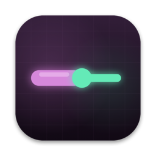
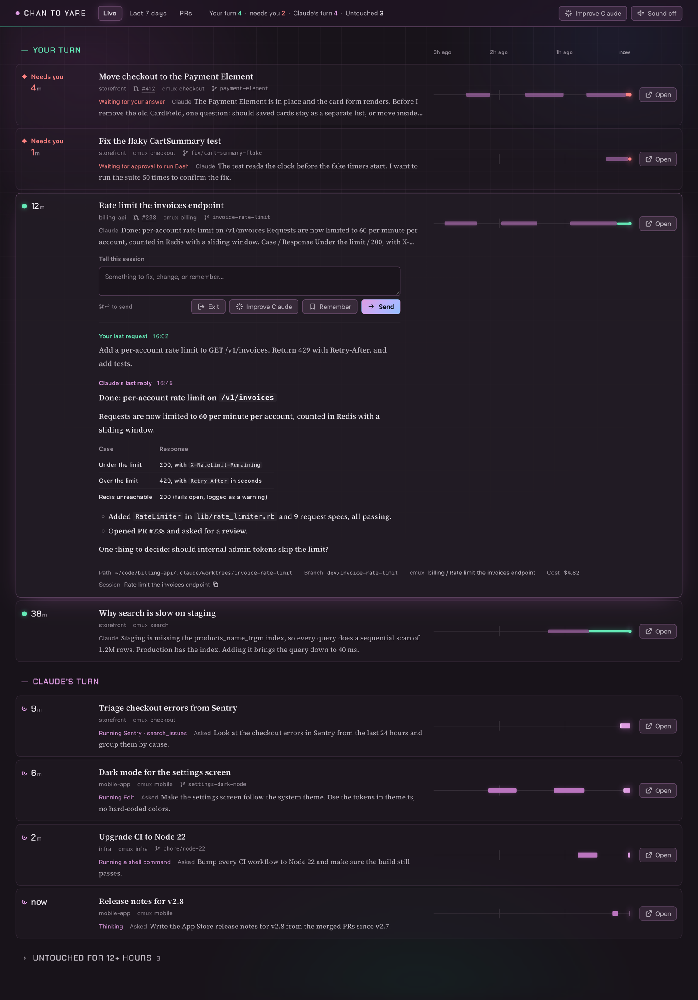
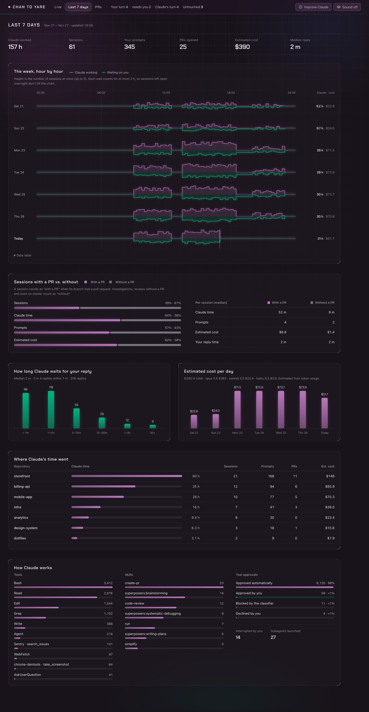
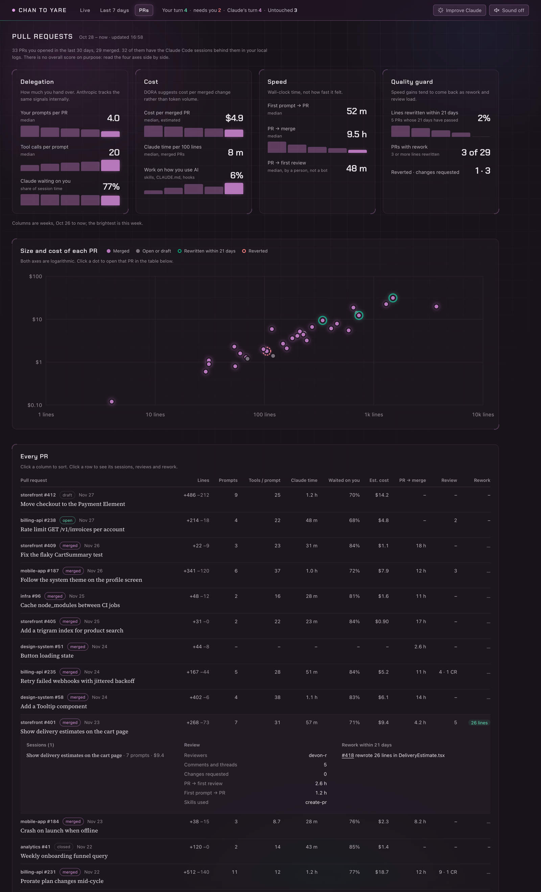

<!-- LOGO -->
<h1>
<p align="center">
  
  <br>Chan to Yare
</h1>
  <p align="center">
    A local dashboard for running many Claude Code sessions in parallel.
    <br />
    See whose turn it is, jump to the right tab, and look back on how you work with Claude.
    <br />
    <a href="#about">About</a>
    ·
    <a href="#features">Features</a>
    ·
    <a href="#install">Install</a>
    ·
    <a href="#usage">Usage</a>
    ·
    <a href="HACKING.md">Developing</a>
  </p>
</p>

## About

Chan to Yare is a dashboard for people who run many Claude Code sessions
at once in [cmux](https://github.com/manaflow-ai/cmux) tabs. When a dozen
sessions are going, it is easy to lose track of which ones are waiting for
you and which ones are still working. Chan to Yare puts every session on one screen, sorted
by whose turn it is, and tells you the moment one needs you.

It reads only what Claude Code already writes to disk (session state and
conversation logs), plus your pull requests through `gh`. There is no
agent to install in your sessions, and the only network calls are to
GitHub and Google Fonts. It is a Node server with zero dependencies, a web
UI, and a thin native macOS app around it.

The name is Japanese for "do it properly."

## Features

### Live



- Sessions are sorted by whose turn it is: Your turn, Claude's turn, and untouched for 12+ hours.
- Each row says why the session is waiting (a question, a plan, a tool approval) or what Claude is running.
- A 3-hour track shows when Claude worked and how long it has waited on you.
- Open a row to read the last exchange, send a note, or end the session. Open jumps to its cmux tab.

### Last 7 days



- The week, hour by hour: how many sessions were working and how many were waiting on you.
- How fast you reply, what it cost per day, and which repositories took Claude's time.
- Which tools and skills Claude used, and how many tool calls you had to approve.

### PRs



- Every PR you opened in the last 30 days, next to the Claude Code sessions behind it.
- Four axes side by side, with no overall score: delegation, cost, speed, and quality guard.
- A size and cost plot that marks PRs rewritten within 21 days or reverted.
- Open a row to see its sessions, reviews, and the PRs that rewrote its lines.

### Ended

- Every session from the last 31 days that is no longer running, newest first.
- Search what you asked, titles, repositories, branches and PRs (`#123`), with Japanese and full-width spaces.
- Resume continues the conversation in a new cmux workspace. Hand off starts a fresh session with a short brief and a pointer to the log.
- Each session shows its context size. Resuming after the prompt cache has expired re-reads all of it, so Hand off is cheaper for a quick follow-up.
- The same Resume and Hand off buttons sit next to each session in the PRs view.

## Install

You need macOS, Node 20 or later, [cmux](https://github.com/manaflow-ai/cmux), and Claude Code.
The PRs view also needs the [GitHub CLI](https://cli.github.com) signed in.

```sh
git clone git@github.com:Ryoma0219/chan_to_yare.git
cd chan_to_yare
node server.mjs   # serves http://127.0.0.1:7878
npm run open      # in another terminal: opens the dashboard in your browser
```

The dashboard's data is locked to people who hold its token
(`~/.config/cc-dashboard/token`, created on first start). `npm run open`
and the macOS app pass it for you. The browser keeps it afterwards, so
later you can open `http://127.0.0.1:7878` directly.

To keep the server running in the background and open the dashboard as a
native app with a Dock badge and notifications:

```sh
cp launchd/com.ryoma0219.cc-dashboard.plist ~/Library/LaunchAgents/   # edit the paths first
launchctl bootstrap gui/$(id -u) ~/Library/LaunchAgents/com.ryoma0219.cc-dashboard.plist
./macos/build.sh --open   # builds ~/Applications/Chan to Yare.app
```

See [HACKING.md](HACKING.md) for details.

## Usage

| View        | What it shows                                                                                             |
| ----------- | --------------------------------------------------------------------------------------------------------- |
| Live        | Every running session, grouped into your turn, Claude's turn, and untouched for 12+ hours                 |
| Last 7 days | When Claude worked and waited on you, how fast you reply, cost, repositories, tools, skills and approvals |
| PRs         | Each PR you opened in the last 30 days next to the sessions behind it, on four axes                       |
| Ended       | Sessions from the last 31 days that are no longer running, searchable, with Resume and Hand off           |

From the Live view you can open a session's cmux tab, read its last
exchange, and send it a note ("Send" or "Remember") without leaving the
board. Sessions in Your turn have an Exit button that sends
`/exit` (click twice). "Improve Claude", in the header or in a session's
note box, opens a new session that changes how Claude behaves: its
CLAUDE.md, skills, hooks, settings, or memory. When a session starts waiting on you, the app plays a sound once,
posts a macOS notification, and updates the Dock badge.

In the app, `⌘1` `⌘2` `⌘3` `⌘4` switch views and `⌘R` reloads.

## Developing

Architecture, data sources, metric definitions, the macOS app, and
security notes are in [HACKING.md](HACKING.md).

## Status

Chan to Yare is a personal tool in daily use.

|  #  | Step                                                     | Status |
| :-: | -------------------------------------------------------- | :----: |
|  1  | Live board with notifications and tab jumping            |   ✅   |
|  2  | Send a note to a session from the board                  |   ✅   |
|  3  | Last 7 days analytics                                    |   ✅   |
|  4  | PR retrospective on four axes                            |   ✅   |
|  5  | Native macOS app with a Dock badge                       |   ✅   |
|  6  | Menu bar item with the count of sessions waiting on you  |   ❌   |
|  7  | Hand-off ledger and a "safe to close" check per session  |   ❌   |
